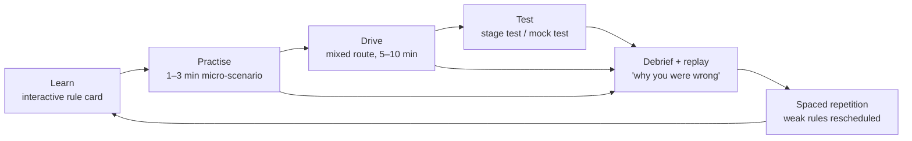

# 01: Product Specification (L to Local)

## 1. Problem
People who move to the UK, and UK learners, need to *apply* British road rules under pressure: on multi-lane roundabouts, in bus lanes, at zebra crossings, and in the lanes of a smart motorway. The current tools fall short:
- **Books and theory apps** teach recall of facts, not doing. The official hazard-perception clips and question banks are DVSA-licensed, so we will not use them.
- **Lessons** are expensive, and you only meet situations when they happen to come up.
- **Driving games** reward speed, not correctness, and do not explain anything.

Our product sits in the gap: *practise the situation, make the mistake safely, and see exactly why it was wrong.*

## 2. Personas

> A note on the brief: it says "right-hand-drive countries or India". A right-hand-drive car means the country *drives on the left*, like the UK and India. I think the two groups that really matter are (a) people who already drive on the left and (b) people who drive on the **right** (right-hand traffic). They need different curricula, so they are separate personas. `ASSUMPTION:` this is what you meant.

| Persona | Background | What they get wrong in the UK | What they need from us |
|---|---|---|---|
| **P1: Experienced left-hand-traffic newcomer** (e.g. from India, Pakistan, Sri Lanka, Bangladesh, Malaysia, South Africa, Kenya) | Years of driving on the left, often in dense, informal traffic | Roundabout priority and lane choice; strict lane discipline; giving way to pedestrians at junctions (H2); bus and cycle lanes; using the horn; not tailgating; camera-enforced limits; yellow box junctions | Unlearn informal priority habits, and fast-track the UK-specific rules |
| **P2: Experienced right-hand-traffic newcomer** (e.g. US, EU, Gulf, Latin America) | Drives on the right; may be used to "right on red" or 4-way stops | Keeping left, especially after turns and when pulling away; clockwise roundabouts; right turns across traffic; no turning on red; mph; mini-roundabouts | Retrain their sense of position, plus rules that differ from home |
| **P3: UK learner** (18–24 at launch, having lessons; 17-year-olds later) | Little or no driving experience | Everything, especially observation and planning ahead | Cheap, safe extra practice between lessons; rehearsing for the mock test |
| **P4: Licence switcher or returner** | Driving in the UK on a foreign licence (`UNVERIFIED:` 12-month limit for non-exchangeable licences), or coming back after a break | Rules that changed (the 2022 hierarchy of road users, the 2023 Welsh 20 mph default, smart motorways) | A diagnostic drive, then targeted practice on gaps |

Motorcyclists, van drivers and HGV drivers are left for later; the data model supports them (doc 04).

## 3. User journeys

### J1: First launch (target: under 3 minutes to driving)
1. Splash screen, disclaimer (section 9), **age gate: 18+ only at launch**.
2. "Where did you learn to drive?" → none / left-hand traffic / right-hand traffic, and the country. This sets the persona and adjusts the curriculum.
3. "Preferred language for learning?" The choice is recorded and English is used for now (doc 03, section 9).
4. Controls tutorial: 60 seconds in an empty car park.
5. **Diagnostic drive**: 4 minutes through a mixed area. A placement result follows, e.g. "You're strong on lights; roundabouts need work."
6. A personalised path on the curriculum map. No account needed; you can sign in later to sync progress.

### J2: A typical daily session (10–15 minutes)
Open the app → coach suggests "Today: 2 weak rules + 1 new topic" → Learn card (30–60 s) → 2–3 micro-scenarios → one mixed drive → debrief with replay of any faults → streak and mastery update.

### J3: Mock test
Choose "Mock test" → 12–15 minute route (independent driving, following signs or a sat-nav arrow) → faults counted in the style of the practical test (driving / serious / dangerous) → pass or fail with a full debrief → the weak rules go into the spaced-repetition queue.

### J4: Free drive in a real city (paid, v1)
Pick a city pack (e.g. your own town) → drive anywhere → rules fire only where the map data is trustworthy (doc 04, section 7) → the debrief works as usual.

### J5: Purchase
Free tier ends (after the first 3 lessons, see doc 03) → paywall offers the one-off £14.99 "Full Licence" unlock (and, if enabled later, "watch an ad to unlock today's next lesson") → purchase goes through RevenueCat → unlocked on every device signed in to the same account.

## 4. Core loop

## 5. Feature list

| Area | MVP (UK launch) | v1 (3–6 months after launch) | Later |
|---|---|---|---|
| Driving | Automatic car, on-screen wheel and pedals, optional tilt, chase and cockpit (right-hand-drive) cameras, indicators, horn, hazard lights, lights, observation gestures (mirror and blind-spot checks) | Wipers and fog lights fully modelled, assist levels per control | Manual gearbox, vans, motorcycles, game controllers and wheels |
| World | 1 hand-authored composite town (all teaching scenarios) + 1 motorway section + 1 rural section | 3–5 curated real-city OSM packs (downloadable) | User-requested cities, a "practise my commute" route builder |
| Rules | 90 catalogue entries (phases P + M; 84 detected in simulation), GB with England/Scotland/Wales overlays | +30 V1 entries: rural, conditions (night, rain, fog), parking detail | Northern Ireland overlay, second country (US) |
| Learning | Curriculum Stages 0–8, rule cards, micro-scenarios, instant feedback, debrief, replay with explanation, spaced repetition, mock test, diagnostic | Coach voice-over, personalised daily plan, mastery map per Highway Code section | Theory Prep mode (original questions), translations, instructor dashboard (B2B) |
| Traffic | Rule-following AI cars, pedestrians and cyclists; scripted teaching events (child steps out, ambulance, cyclist undertakes, car cuts in) | Buses (stopping, pulling out), more varied driver behaviour | Horses, tractors, trams, police stops |
| Platform | Android + iOS, offline-first, optional account, cloud save, crash reporting, analytics with consent | Remote-configurable content updates, city pack downloads | Leaderboards (opt-in), web demo |
| Monetisation | Free tier (first 3 lessons), £14.99 "Full Licence" one-off unlock, restore purchases | Optional rewarded-ad unlocks (remote-config toggle) | Family sharing, driving-school licences (B2B) |
| Accessibility | Text size, colour-blind-safe palette, subtitles, haptics on/off, assist levels, plain-English glossary | Audio narration, left-handed control mirroring | Screen-reader support in menus |

## 6. Monetisation model (from your answers)
- **Free download.** The controls tutorial, the diagnostic drive and **the first 3 lessons** are free. The paywall comes straight after lesson 3's recap, when the user has just seen a replay explain a mistake. That replay is the moment the value is clearest.
- **"Full Licence" one-off purchase** unlocks all stages, mock tests, city packs released during the product's life, and full replay history. **Price: £14.99** (decided 2026-11-25). No subscription in v1, because learners want to "buy it, finish it, pass".
- **Rewarded ads (optional, remote-config):** watch one ad to unlock one locked lesson for 24 hours, up to N per day. There are no banner or interstitial ads anywhere. The app is 18+ at launch. Ads are personalised only with consent (UMP on Android, ATT on iOS); otherwise they are non-personalised.
- Paid users never see ads.

## 7. Success metrics

| Metric | Definition | Target (launch + 90 days) `ASSUMPTION` |
|---|---|---|
| **Rule mastery %** | A rule is *mastered* when applied correctly in ≥3 distinct scenario contexts across ≥2 different days, and the latest attempt had no fault on it. Mastery % = mastered rules ÷ rules in the user's curriculum, weighted by commute frequency (doc 02, section 4). | 50% of paying users reach ≥80% weighted mastery |
| Diagnostic → mock-test improvement | Change in fault count between the diagnostic and the 3rd mock test | −60% faults |
| Retention | D1 / D7 / D30 | 40% / 20% / 10% |
| Free → paid conversion | Installs that buy the Full Licence | ≥4% |
| Debrief engagement | % of faults where the replay was opened | ≥35% |
| Learning confidence | In-app survey: "I know what to do at a multi-lane roundabout" (before and after, 1–5) | +1.5 points |
| Quality | Crash-free sessions; frame rate on target device | ≥99.5%; ≥30 fps on the 95th-percentile frame |
| Correctness | Rule disputes reported by users and confirmed as our bug | <1 per 1,000 drives |

## 8. Explicitly out of scope
- Booking tests, real DVSA content (hazard-perception clips, theory question banks), and anything that implies official endorsement.
- The theory test (planned as a later mode, not v1).
- Manual gearbox, motorcycles and other vehicles in the MVP.
- Realistic graphics, VR, multiplayer and live traffic data.
- Northern Ireland at launch: it has its own Highway Code. **Decided: GB only at launch.**
- Users under 18 (decided: 18+ only at launch). Supporting 17-year-old learners later needs Children's Code work (doc 04, section 12).
- Legal advice on fines and points beyond information panels.

## 9. Disclaimer (shown at first launch, in Settings, and in store listings)
> **This app is an educational practice tool.** It does not replace lessons with an approved driving instructor, the official theory test, or the practical driving test. It is not affiliated with or endorsed by DVSA, DfT or any government body. Always follow the current Highway Code, road signs, and instructions from the police and traffic officers. Contains public sector information licensed under the Open Government Licence v3.0. Map data © OpenStreetMap contributors, available under the Open Database Licence.

The OGL wording reflects that GOV.UK Highway Code pages state "All content is available under the Open Government Licence v3.0, except where otherwise stated" (checked 2026-11-25). The OGL does not allow us to imply endorsement, so we use no government logos.
