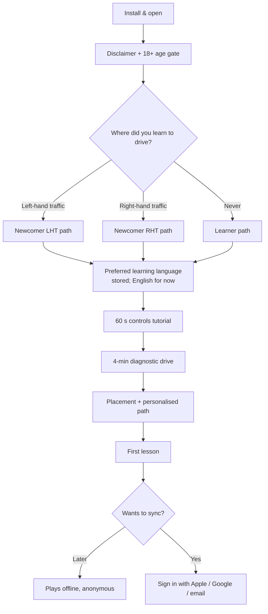

# 03: Gameplay and Learning Design

## 1. Design pillars
1. **Learn by doing, then understand why.** Every rule is met *in a situation* before or alongside its explanation.
2. **Instant and fair.** Feedback arrives within about 0.5 s of the mistake, names the rule, and can always be replayed. If the sim isn't sure (low data confidence), it doesn't mark you.
3. **Correct beats fast.** No points for speed, ever. The reward is a calm, clean drive.
4. **Small sessions.** Everything fits in 10 minutes, and the curriculum respects the user's time.
5. **Honest about limits.** It's a practice tool, not a test or a substitute for lessons.

## 2. Curriculum (from L-plate to "Full Licence")

Stages unlock in order. Inside each stage, the user picks the order of topics. The diagnostic drive (doc 01, J1) can **fast-track** an experienced driver past stages they already handle well: the stage test is offered straight away.

| Stage | Theme | Topics (rule groups from doc 02) | World area | Stage test | Tier |
|---|---|---|---|---|---|
| 0 | Orientation | Controls, keeping left, observation gestures, moving off, MSM | Car park + quiet estate | — | Free (lessons 1–3 of the free tier start here) |
| 1 | Quiet roads | Speed limits (inc. Wales 20), road position, junction types, give way, H2 pedestrians | Residential area | 5-min drive | Paid after free lesson 3 |
| 2 | Lights & crossings | Traffic lights, filter arrows, box junctions, zebra/pelican/puffin/toucan, ASLs | Town centre (part) | 6-min drive | Paid |
| 3 | Roundabouts | Normal, mini, double-mini, multi-lane, spiral, signalised; cyclists on roundabouts | Roundabout district | 8-min drive | Paid |
| 4 | Busy town | Bus lanes (time plates), cycle lanes, overtaking cyclists, school zones, emergency vehicles, parking basics | Town centre (full) | 8-min drive | Paid |
| 5 | Faster roads | Dual carriageways, overtaking, two-second rule, lane discipline, merge in turn, roadworks | Ring road + A-road | 8-min drive | Paid |
| 6 | Motorways | Joining/leaving, lane discipline, red X, variable limits, hard shoulder, emergency areas, **breakdown procedure** | Motorway section | 10-min drive | Paid |
| 7 | Conditions *(V1)* | Night, rain, fog, rural lanes, single track, level crossings, horses | Rural section | 8-min drive | Paid |
| 8 | Mock tests | Mixed 12–15-min routes, independent driving (signs or sat-nav arrow), test-style marking | Whole world | Pass = **"Full Licence" badge** | Paid |

**Persona tuning.** The curriculum is the same for everyone. What changes per persona is the **emphasis and default ordering**:
- P2 (right-hand-traffic drivers) gets extra "keep left after turning" reps and the clockwise-roundabout animation in Stage 0.
- P1 gets H2 pedestrian priority, lane discipline and bus-lane reps.
- Weights come from the persona's diagnostic results, not stereotypes.

### Unit of content: the *Lesson*
`Lesson = Learn card (30–60 s) → 2–4 micro-scenarios (1–3 min each) → recap`
- **Learn card**: an animated, interactive top-down diagram (drag the car to the right lane, tap who has priority). It includes the Highway Code rule number and a "Read on GOV.UK" link. All text is our own paraphrase.
- **Micro-scenario**: a single situation set up by the **scenario director** (doc 04, section 8) with randomised variations: traffic density, gaps, the pedestrian's intent, time of day. This stops users memorising answers.
- **Recap**: what you did well, what to watch for, and when the rule will come back (spaced repetition).

## 3. Instructor / coach system
- **Coach character**: a calm, friendly, non-judgemental instructor. Text-first in the MVP; a recorded English voice in V1. The coach is a deliberately *original* character, not modelled on any real instructor or brand.
- **Four intervention levels** (set automatically by stage, user can change them):

| Level | Before the event | During | After |
|---|---|---|---|
| L1 Guided (Stage 0–1 default) | Prompts ("Roundabout ahead: which exit? Choose your lane") | Freezes time on **dangerous** faults and shows the fix | Full debrief |
| L2 Coached | Hints only for new topics | Short toast (icon + 3–6 words) | Full debrief |
| L3 Independent | None | Silent except dangerous | Full debrief |
| L4 Test | None | Silent | Test-style result sheet + debrief |

- **Tone rules for coach copy**: plain English (CEFR B1); name the rule and give the reason; never shame; one fix per message. Example: *"You entered the roundabout as a car came from the right. Give way to traffic from your right: wait for a gap."* (Highway Code rule 185).

## 4. Controls and the observation mechanic
- **Steering**: an on-screen wheel (left thumb) by default; tilt as an option; assisted steering at low levels (lane-keeping nudges). **Steering sensitivity** defaults to 60% (play-test 2026-11-25: 100% felt too fast). It is saved on the device, and a **Settings** screen will let users adjust it (30–150%).
- **Pedals**: accelerator and brake on the right; automatic gearbox; parking brake button for hill starts in V1.
- **Indicators**: two stalk buttons at the top corners; self-cancelling after the turn (as in a real car), with manual cancel.
- **Observation: decided 2026-11-25 after the first play-test.** Explicit mirror taps and shoulder-check buttons felt like a chore, so players are **not** asked to perform observation actions. The game judges the *outcome* instead. For example, if a car was in your blind spot or alongside, or had to brake when you changed lane, the fault message explains that a mirror check and a look over the shoulder would have shown it. The mirrors stay on screen as normal mirrors, and an optional "Look left / Look right" view remains, but nobody is marked on it. The original design is kept below for reference.
- *(Superseded)* **Observation**: a quick gesture glances at the mirrors (swipe up for interior, left/right edge taps for door mirrors) and a short swipe from the edge looks over the shoulder. On screen it shows a brief mirror inset or a camera head-turn. Each glance emits an `obs_event` for the rules engine.
  - **Risk**: this can feel like busywork. Mitigation: in Stage 0–1, a ring around the mirror icon pulses when a check is due. At L1, a missed check gets a coaching nudge, not a fault. **Play-testing in the prototype decides whether the mechanic stays** (doc 07, hypothesis H3).
- **Cameras**: chase cam by default; cockpit cam with a **right-hand-drive interior** so P2 users build a feel for road position; top-down replay cam.
- **Haptics**: a short pulse on faults, and when crossing a lane line without signalling (can be turned off).

## 5. Feedback: instant, debrief, replay
### 5.1 Instant
| Severity | In-drive feedback |
|---|---|
| Good practice ★ | A quiet green tick near the speedometer (e.g. "Good mirror check") |
| Driving fault (D) | Amber toast with an icon: "Signal earlier" |
| Serious (S) | Red toast + haptic + a 1 s slow-motion pulse |
| Dangerous (X) | Time freezes; a mini-replay of the last 4 s; the fix shown; resume or restart the scenario |

### 5.2 Post-drive debrief
- **Summary**: faults by category (D/S/X), with good practice shown first.
- **Fault list** grouped by rule. Tapping a fault opens its **"why you were wrong" replay**:
  1. Replay from **6 s before to 3 s after** the event, from a camera chosen by the rule's `replay_camera` (bird's-eye for lanes, other driver's view for priority, side-on for cyclist clearance).
  2. **Overlays**: a ghost car shows *what you should have done* (a pre-computed reference path: correct lane, stop point, gap); the timing bar marks where the signal or mirror check should have been; distance rulers.
  3. **Explanation** (2–3 lines) + legal force ("The law says you **must**…" vs "The Highway Code advises…") + rule number + GOV.UK link.
  4. **"Try this again"**: jumps straight into a micro-scenario built around the same rule.
- **Disputes**: a "This doesn't look right" button attaches the replay file and rule trace to a report. This is our main correctness feedback loop (doc 06).

### 5.3 Scoring
- **Drive result** uses test-style faults: Pass = ≤ 15 driving faults, 0 serious, 0 dangerous. `UNVERIFIED:` the DVSA pass criteria wording must be checked against the GOV.UK practical-test page before it appears in the UI.
- **No numeric "score" leaderboards** in the MVP. Scores invite speed-running a learning tool.
- **Mastery per rule**: 0–4 levels (New → Practising → Familiar → Mastered → Locked-in). The definition is in doc 01, section 7. Shown on the **Mastery Map**, a grid of Highway Code sections.

## 6. Spaced repetition of weak rules
- Every rule the user meets has a memory record: `{rule_id, stability, difficulty, last_seen, last_outcome, contexts_seen[]}`.
- The scheduler is a simplified **FSRS-style** model (the open-source algorithm many flashcard apps use) where the "review" is *a scenario that exercises the rule*, not a flashcard:
  - Correct application → interval grows (1 d → 3 d → 7 d → 16 d …).
  - A fault → interval resets; severity scales the penalty.
  - **Context variety**: a rule only reaches *Mastered* after success in ≥ 3 distinct contexts (e.g. zebra crossing at day, at night, and with a queue).
- The **daily plan** = due reviews (max 3) + 1 new topic + an optional free drive. Reviews are delivered as micro-scenarios tagged with the rule (doc 04 scenario tags), so a single scenario can review several due rules at once.

## 7. Mock-test mode
- A 12–15 minute route through the whole world area, including ~10 min of **independent driving** (follow road signs to a named destination, or follow a sat-nav arrow).
- Original "show me / tell me" style vehicle questions are **not** in v1. They belong in the later Theory Prep mode; all questions will be original, and we will never use the DVSA question bank.
- Test-style result sheet, then a full debrief. Weak rules feed into spaced repetition.
- Pass three different mock-test routes → the **Full Licence** badge (cosmetic, clearly not a real licence).

## 8. Free-drive mode (V1, real streets)
- Choose a downloaded city pack and drive anywhere. Optionally pick a destination (sat-nav arrow).
- Rules fire only on map elements with **confidence ≥ threshold** (doc 04, section 7). A small "unverified area" badge shows where we aren't marking.
- Scripted teaching events can spawn in free-drive (child steps out, ambulance) via the director, rate-limited.
- **Later**: "Practise my commute": enter start and end, and the app builds a route inside the pack and pre-teaches the junctions on it.

## 9. Language, non-native English speakers, and future translations
**v1: English only**, written for non-native speakers:
- Plain English at **CEFR B1**: short sentences, one idea each, no idioms ("hold your horses"), no unexplained abbreviations.
- **UK driving glossary**, tappable everywhere: give way, dual carriageway, national speed limit, nearside/offside, A-road, hard shoulder, filter, zig-zags, box junction. Each entry has a mini-diagram.
- Icons and diagrams carry meaning before text.
- Units: **mph** throughout; a one-time km/h hint (e.g. "30 mph ≈ 48 km/h") for P2 users.

**Scope for future translations, based on the user's preferred learning language:**
- Onboarding asks *"Which language would you like to learn in?"* now, even though only English is available. It is stored as `preferred_learning_locale` and reported in analytics (with consent), so **real demand decides which language comes first**. `ASSUMPTION:` Tamil, Hindi, Urdu, Punjabi, Polish, Romanian and Arabic are likely early candidates.
- Note: **UI language and learning language can differ.** A user may want the coach to explain in Tamil while **road signs and in-world text stay in English**, because that is what they'll see on real roads.
- What has to be ready from day one (cheap now, costly later):
  - All strings live in string tables with keys; nothing is hard-coded. Plural and gender handling uses ICU MessageFormat.
  - Glossary terms are **linked IDs**, so translations stay consistent, and the English term can be shown next to the translation ("Give way (வழிவிடு)").
  - Rule explanations are stored per `rule_id` per locale inside the country pack (`strings/<locale>/rules.json`).
  - Layout is checked for long strings (+40%) and RTL scripts (Arabic, Urdu) in UI mock-ups.
  - Fonts: Noto families planned; bundled per locale as downloadable assets to keep the base app small.
  - Voice lines are stored as `voice/<locale>/<line_id>`, recorded or TTS-generated per locale later.
- Translation quality bar (later): professional translation + review by a native-speaking **UK driver**, because legal force (MUST vs should) must survive translation.

## 10. Accessibility
| Need | MVP support |
|---|---|
| Vision: colour blindness | Signals and lane overlays use shape + colour; colour-blind-tested palette |
| Vision: low vision | Text size up to 200% in menus; high-contrast HUD option |
| Hearing | Every audio cue has a visual equivalent; subtitles for all coach lines; sirens shown as an on-screen direction marker |
| Motor | Assist levels: auto-steer lane keeping, auto speed hold, larger touch targets, one-handed layout (V1) |
| Cognitive | Reduced-pace mode (sim at 0.75× speed in practice, never in tests); one instruction at a time |
| Motion sensitivity | Reduced camera shake/bob; FOV slider; cockpit cam is optional |
| Screen readers | Menus labelled for TalkBack/VoiceOver in V1 (`UNVERIFIED:` maturity of Unity's mobile screen-reader support, to be tested) |

## 11. Engagement without gimmicks
**Do:**
- A **streak** that forgives (a weekly target of 3 sessions rather than daily, plus a "freeze").
- A **Mastery Map** that fills in.
- **Badges** for real competence ("Spiral roundabout: 5 clean exits").
- **Challenge scenarios** (e.g. "Rush hour roundabout").
- A visible "Days until your test" countdown if the user enters a test date.
- A weekly recap notification (opt-in).

**Don't:** energy or timers for paid users, loot boxes, random rewards, leaderboards that reward speed, interstitial ads, or dark patterns in the paywall (doc 01, section 6).

**Free tier:** the first 3 lessons (+ controls tutorial and diagnostic drive). **Optional later ads:** rewarded only, user-initiated ("Watch an ad to unlock today's next lesson"), capped per day, personalised only with consent, never during a drive.

## 12. Onboarding flow (MVP)

