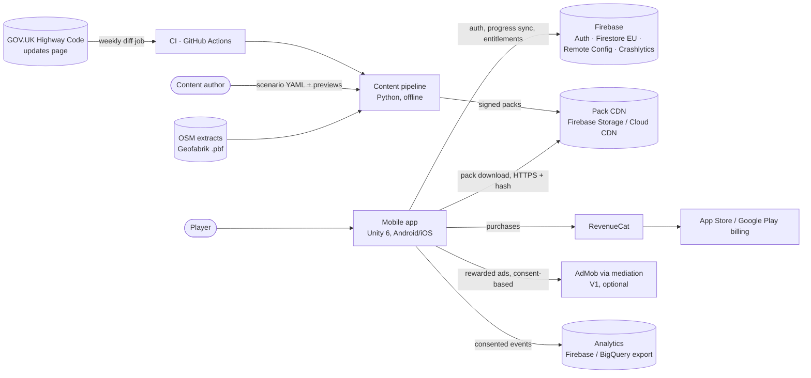
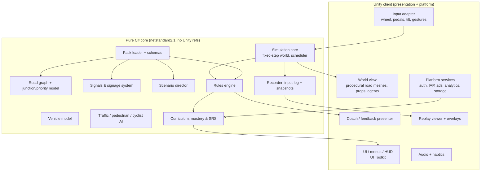
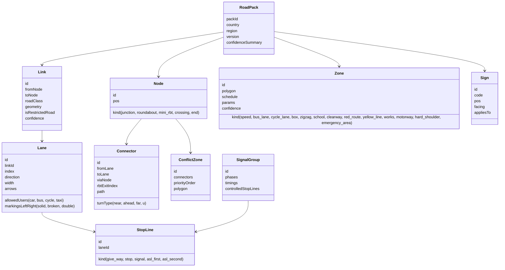
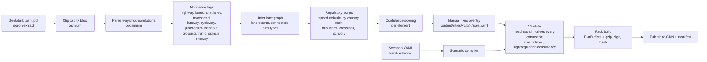
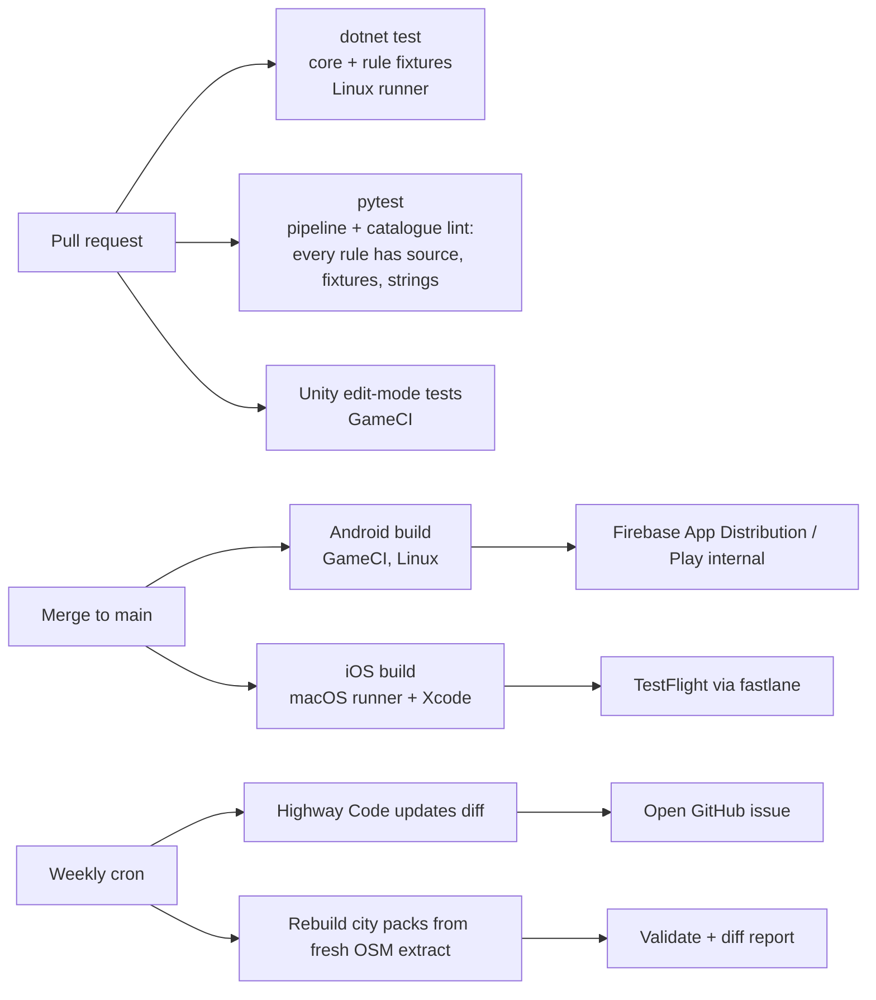

# 04: Architecture

## 1. Principles (and where I changed the brief)
| # | Principle | Notes |
|---|---|---|
| 1 | **Simulation core separate from presentation** | Plain C# libraries with **no Unity references**. Unity is a *view and input adapter*. The same core runs headless in tests, in CI, and in the content pipeline's validation step. |
| 2 | **Fixed timestep, replay-safe** | Sim runs at **50 Hz** with fixed `dt = 0.02 s`, using a single seeded RNG. **Challenge:** bit-exact float determinism across ARM CPUs, iOS/Android and compiler builds is *not* guaranteed in C#/IL2CPP. So replays = **input log + full state snapshot every 1 s**, and playback re-simulates from the nearest snapshot. Within one build on one device, results are deterministic; across devices we don't depend on it. Cross-platform lockstep would only be needed for multiplayer, which is out of scope. |
| 3 | **Rules engine is pure and data-driven** | It consumes `DriverFrame` + events and emits `RuleEvent`s. Rules are pack data on top of ~20 coded rule *kinds*. It does **not** use a general rule DSL or a Rete engine (see ADR-003). |
| 4 | **Country = data pack** | Driving side, speed defaults, sign set, rule pack, strings and scoring live in the pack. Code speaks in **nearside/offside** and **near turn/far turn**, never left/right. |
| 5 | **One road format for both content types** | Hand-authored scenarios and OSM city packs both compile to the same **RoadPack** (lane-level graph + regulatory zones). The client generates meshes procedurally from it, so there is one mesh generator and small downloads. |
| 6 | **Offline-first, thin backend** | Everything playable offline after the pack is downloaded. The backend handles auth, progress sync, entitlements, pack delivery and remote config. |
| 7 | **Mobile budgets are design inputs** | 30 fps on a 2021 mid-range Android (target 33 ms frame; sim ≤ 4 ms, rules ≤ 1 ms, render ≤ 20 ms). Base app download ≤ 150 MB; city packs ≤ 25 MB each. |

## 2. System context


## 3. Layered component view


**Assembly / repo layout (proposed)**
```
/core/                      .NET solution, builds outside Unity
  Sim.Core/                 world, scheduler, RNG, snapshots
  Sim.Vehicle/
  Sim.Roads/                lane graph, conflicts, zones, signals
  Sim.Agents/               IDM/MOBIL, pedestrians, cyclists, director
  Rules.Core/               DriverFrame, rule kinds, evaluator
  Learning.Core/            curriculum, mastery, SRS scheduler
  Packs.Schema/             FlatBuffers/JSON schemas + loaders
  *.Tests/                  NUnit; scenario fixtures
/unity/                     Unity project; references core as DLLs/UPM package
/pipeline/                  Python: osm → roadpack, scenario compiler, validators
/content/
  countries/gb/             country pack source (YAML)
  scenarios/                hand-authored scenarios (YAML)
  cities/                   per-city pipeline configs + manual fixes
/docs/
```

## 4. Simulation core
**Tick loop (50 Hz).** Rendering interpolates between the last two sim states, so the frame rate is independent of the sim rate.

```mermaid
sequenceDiagram
  participant U as Unity Update()
  participant S as Sim.Step(dt)
  participant R as Rules.Evaluate
  participant C as Coach/UI
  U->>S: InputFrame (steer, throttle, brake, indicator, obs gestures)
  S->>S: 1. Signals & director advance
  S->>S: 2. AI agents plan (IDM/MOBIL, gap acceptance)
  S->>S: 3. Vehicles integrate (ego + agents)
  S->>S: 4. Localise on lane graph, update zones & conflicts
  S->>S: 5. Recorder: append input; snapshot every 50 ticks
  S->>R: DriverFrame + SimEvents
  R-->>S: RuleEvents (violation / satisfied / near-miss)
  S-->>U: WorldState (for interpolation) + RuleEvents
  U->>C: present feedback
```

**World state** is plain data arrays (struct-of-arrays for agents) to keep GC allocations at zero per tick. That matters for IL2CPP on mobile.

## 5. Vehicle model (arcade-realistic)
- **Kinematic bicycle model** at low speed blending into a **dynamic single-track model with a linear tyre** above ~15 km/h. The yaw response feels real, there is no drifting, and it's stable at 50 Hz.
- Longitudinal: an engine force curve (automatic), drag, rolling resistance, brake force limited by a µ that depends on the surface (dry 0.8, wet 0.5, ice 0.1, `ASSUMPTION` tuning values).
- This gives physically plausible **stopping distances** that match the Highway Code teaching (we tune reaction + braking to land near the typical-stopping-distance table, *once those values are verified*).
- Assist layer: lane-keep torque, speed hold, ABS always on.
- **We do not use Unity PhysX/WheelCollider for driving.** Reasons: non-deterministic, frame-coupled, hard to test headless. PhysX may still be used for *visual-only* props (cones knocked over).

## 6. Road graph, junction and priority model
### 6.1 Data model (RoadPack)


### 6.2 Priority model
- Every **ConflictZone** is the overlap of connector paths. It holds an ordered **priority** decided at pack-compile time from: the node kind, stop and give-way lines, the signal group phase (dynamic), roundabout circulation, and pedestrian and cyclist crossing rules (H2/H3).
- At runtime, the sim computes for each agent approaching a conflict: arrival time, TTC, and the deceleration the other agent needs. AI uses it for **gap acceptance**; the rules engine uses the *same* numbers to judge the player. One source of truth means AI and judging can't disagree.
- **Driving side** is resolved at compile time. The pipeline sets `turnType` (near/far), circulation direction (clockwise for left-hand traffic), and `priority_from: offside`. Rule packs only ever say "offside"/"far turn".

### 6.3 Signals & signage
- `SignalGroup` state machines (red → red+amber → green → amber for GB; pelican has flashing amber; puffin/toucan/equestrian don't). Sequences come from the **country pack**, not code.
- Signs are entities placed in the world: a *visual* (from the sign set) plus a link to the *regulation* they create (zone or lane attributes). Rules use regulations, never sign visuals. This lets us flag mismatches (a sign present without a regulation, or the other way round) in pipeline validation.
- Variable message gantries (motorway) are `SignalGroup`s with lane-level aspects (speed / red X / arrow).

## 7. Content pipeline (offline, Python)

- **Confidence scoring**: e.g. a lane with an explicit `lanes=` and `turn:lanes=` tag = high; inferred from road class = low; a bus lane without `:conditional` times = low. The client **only fires rules on elements at or above the rule's minimum confidence** (each rule declares `min_confidence`). Otherwise the drive just continues and an "unverified area" badge shows.
- **Hand-authored scenarios** are YAML (lane graph + zones + agent scripts + director cues), with a Unity editor preview window. Building a full visual road editor is **out of scope** for the MVP (risk). Optional: buy an Asset Store road tool for visual layout and export it to our YAML (ADR-005).
- **No live Overpass calls from the app.** Pipeline runs use local `.pbf` extracts.

### 7.1 OSM licensing impact (ODbL)
| Question | Answer for us |
|---|---|
| Is a city RoadPack a *Derivative Database*? | **Yes.** It is OSM data transformed (lanes inferred, zones added). |
| Obligation | The pack data must be licensed under ODbL, and on request we must offer the pack data (or the means to recreate it) under ODbL. **Our manual fixes inside packs become ODbL too.** |
| Is the rendered game view a *Produced Work*? | Yes. Attribution is required; the game itself (code, art, curriculum) is **not** share-alike. |
| Attribution | "© OpenStreetMap contributors" + ODbL link: on the free-drive screen (visible without interaction), in the credits, and in store listings. Following the OSMF Attribution Guideline (adopted 2021-06-25). |
| Mixing with proprietary data | Avoid mixing proprietary map data into packs. Keep scenario (non-OSM) worlds separate. Hand-authored scenarios that are *not derived from OSM* remain ours. |
| Practical step | Publish the city pack source data (the OSM-derived layer) as ODbL downloads on a simple public page or repo. Low cost, and it removes the risk. |

Sources: [OSMF Licence & Legal FAQ](https://osmfoundation.org/wiki/Licence_and_Legal_FAQ), [OSMF Attribution Guideline](https://osmfoundation.org/wiki/Attribution), [Produced Work guideline](https://wiki.openstreetmap.org/wiki/Open_Data_License/Produced_Work_-_Guideline). `ASSUMPTION:` this is a reasonable reading of community guidance; get a short legal review before launch.

## 8. Traffic & pedestrian AI
- **Car following**: Intelligent Driver Model (IDM). **Lane changes**: MOBIL. Both are well-documented, cheap, and tunable for "polite UK" vs "aggressive" driver profiles.
- **Junctions**: gap acceptance on the shared ConflictZone model. AI follows signals, give-way lines, roundabout priority, H2/H3.
- **Pedestrians**: on footway graphs and crossings, with intents (`walk`, `wait_to_cross`, `cross`, `child_dart`). **Cyclists**: lane-following agents with lateral position, primary/secondary positioning, ASL use.
- **Scenario director**: places and scripts **teachable events**. These are deterministic for a given seed, and the AI is otherwise rule-abiding:
  - `child_step_out` (behind a parked van), `ambulance_approach` (from behind, with sirens), `cyclist_undertake`, `car_cut_in`, `bus_pull_out`, `ai_flash_headlights`, `breakdown_start`, `red_x_ahead`, `phone_buzz`.
  - Events declare **preconditions** (speed, distance, sightline) so they are fair: never spawn a hazard the player physically couldn't avoid at a legal speed.
- **Agent count budget**: ≤ 40 vehicles + 30 pedestrians active near the player. Distant agents are simulated cheaply (lane-position only) or not at all.

## 9. Rules engine
### 9.1 Contract
```csharp
// Rules.Core: no Unity dependency
public interface IRuleKind {            // implemented in C# (~20 kinds)
    string Kind { get; }                // e.g. "fail_to_give_way"
    IRuleInstance Bind(RuleDef def, CountryPack pack);
}
public interface IRuleInstance {
    void OnFrame(in DriverFrame f, RuleContext ctx);   // per tick
    void OnEvent(in SimEvent e, RuleContext ctx);      // discrete events
}
public readonly record struct RuleEvent(
    string RuleId, RuleOutcome Outcome,   // Violation | Satisfied | NearMiss | GoodPractice
    Severity Severity,                    // D | S | X
    double SimTime, EvidenceRef Evidence, // ids of agents/zones + metric values
    float Confidence);                    // min(confidence of elements involved)
```
### 9.2 Rule kinds (initial set)
`speed_over_limit`, `speed_inappropriate`, `headway_below`, `fail_to_give_way`, `enter_zone_when_forbidden` (bus lane, box, cycle lane, hard shoulder, red-X lane), `stop_line_crossed_on_aspect` (red, red+amber, ASL, level crossing), `fail_to_stop_at`, `observation_missing_before` (MSM/move-off/lane change), `signal_timing`, `signal_mismatch`, `lane_choice_for_exit` (roundabouts, arrows), `lateral_clearance_below`, `overtake_where_forbidden`, `stationary_in_zone` (parking/stopping), `lane_hogging`, `wrong_way`, `lights_state_required`, `scripted_response` (breakdown, emergency vehicle, phone), `progress_too_slow`, plus **code rules** for multi-step procedures (`roundabout_signal_sequence`, `breakdown_procedure`).

### 9.3 Evaluation details
- **Per-rule state machines** (e.g. armed → watching → violated / satisfied) avoid duplicate firing; **cool-downs** stop spam (e.g. one speeding event per zone visit, escalating if sustained).
- **Severity escalation** is declarative (doc 02, section 3).
- **Context tags** on every event (`stage`, `scenario_id`, `persona`, `env`) feed mastery and analytics.
- **Explainability**: every event carries an `EvidenceRef` (e.g. `{other_agent: 42, ttc: 1.8 s, decel_req: 4.2}`). The debrief renders explanations and the replay overlay from this, so it never shows hand-waving text.
- **Testing**: every rule has **fixtures**: tiny scenario + scripted inputs + expected `RuleEvent`s, run headless in `dotnet test`. Target: 3 fixtures per rule (pass, minor, serious/dangerous). Doc 02's `fixtures:` field links them.

## 10. Feedback / coach, replay, progress
- **Coach system** maps `RuleEvent` + intervention level → presentation (toast, freeze, voice line). Copy comes from the country pack's string tables, keyed by `rule_id` + outcome + severity.
- **Replay**: the recorder keeps a **ring buffer of the last 60 s** (instant "what happened?") plus a whole-drive log saved locally (~200–400 KB per 10-minute drive, `ASSUMPTION`). Playback restores the nearest snapshot and re-simulates with logged inputs. Reference "ghost" paths are computed by running the AI driver from the same snapshot.
- **Progress / curriculum service** (`Learning.Core`): curriculum graph from the country pack; mastery records; SRS scheduler; daily plan. Local-first in SQLite, synced to Firestore (last-writer-wins per rule record, merged by max mastery).

## 11. Country / locale packs
```
countries/gb/
  pack.yaml                 # id, driving_side: left, units: imperial_mph, regions: [ENG, SCT, WLS]
  speed_defaults.yaml       # road class × vehicle → limit; region overlays (WLS restricted = 20)
  signals.yaml              # light sequences per signal type
  signs/                    # sign catalogue: code → texture, regulation template
  rules/*.yaml              # rule definitions (doc 02)
  curriculum.yaml           # stages, lessons, scenario tags
  scoring.yaml              # fault thresholds, pass criteria
  strings/en-GB/*.json      # UI, coach, rule explanations, glossary
  voice/en-GB/
```
**Adding a right-hand-traffic country (e.g. US) is mostly content, with three known code additions:**

| Area | Content only? | Notes |
|---|---|---|
| Driving side, roundabout circulation, near/far turns | ✅ | Resolved in compile + config |
| Units, speed defaults, sign set, strings | ✅ | |
| Most rules (speed, give way, lights, crossings, headway) | ✅ | Same rule kinds, new params |
| Right-on-red, 4-way stops (first-come priority), school-bus stop law | ❌ new rule kinds | `first_arrival_priority`, `conditional_turn_on_red`, `school_bus_stopped` |
| State-by-state variation | ⚠️ | Region overlays (as GB uses ENG/SCT/WLS) |
| Hand-authored scenarios | ⚠️ | Can be **mirrored** automatically (geometry flip + sign swap) as a starting point, then reviewed |

## 12. Backend, privacy, analytics
- **Firebase**: Auth (Apple, Google, email; anonymous by default), Firestore **EU location** (progress, settings), Storage + CDN (packs), Remote Config (feature flags, ad toggle, prices for display), Crashlytics.
- **RevenueCat**: one non-consumable "Full Licence" product (£14.99) on both stores; entitlement checked offline from cache; cross-platform via the shared app user ID.
- **No custom server in the MVP.** Firebase security rules restrict each user to their own documents. Cloud Functions are only needed later (e.g. account deletion webhooks, B2B).
- **Privacy**:
  - UK GDPR applies. **The app is 18+ at launch** (age gate in onboarding and an 18+ store age rating; `UNVERIFIED:` exact rating questionnaire answers). Defaults still follow high-privacy practice:
    - analytics only after consent
    - minimal data
    - personalised ads (if ads ship) only with consent
    - account deletion in-app
  - Allowing 17-year-old learners later brings in the **ICO Age Appropriate Design Code (Children's Code)**: non-personalised ads, no profiling, a children's-data DPIA. It is planned as a separate decision.
  - Store disclosures: Data Safety on Google Play and Privacy Nutrition Labels on iOS. No ATT prompt needed if we don't track (`ASSUMPTION`, confirm against Apple's rules once the ad SDK is chosen).
  - Google Play policy: users 16–17 may count as children in some locales; follow the Families/age-screen guidance if we target mixed audiences ([Play policy](https://support.google.com/googleplay/android-developer/answer/9893335)).
- **Analytics events** (consented): `lesson_start/complete`, `rule_event` (rule_id, outcome, severity, scenario, no location), `replay_open`, `dispute_submit`, `paywall_view`, `purchase`, `ad_reward`, `preferred_learning_locale`. Free-drive positions are **never** uploaded; only rule IDs and aggregate km.

## 13. Build, test, CI/CD

- **Performance gate**: a headless benchmark of the busiest scenario must stay under the sim + rules budget (doc 04, section 1). Manual device check on the reference phone each milestone.
- **Unity licence in CI**: GameCI needs a Unity licence activation for Personal (`UNVERIFIED:` current activation process for Unity 6 in CI; alternative is Unity Build Automation, which is paid).

## 14. Performance plan (mobile)
- URP mobile renderer, baked lighting for static content, one directional real-time light, no real-time shadows on agents at low tier.
- Procedural roads batched per tile (~200 m tiles), GPU instancing for props/agents, 3 LODs + impostors for buildings (extruded OSM footprints, flat-shaded).
- Draw calls ≤ 150, triangles ≤ 300k on screen, texture atlas per pack.
- Quality tiers chosen by device benchmark at first launch.
