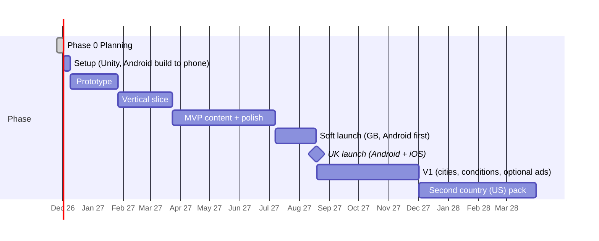

# 06: Roadmap, Effort and Risks

## 1. Team setup (decided 2026-11-25)
- **Claude writes the code**: core libraries, Unity scripts, pipeline, tests and content YAML, in small reviewed steps.
- **You** install the tools, run builds on your OnePlus 12, play-test, judge feel and make product decisions. Your hardware is a MacBook Air (M5), which builds both Android and iOS.
- Bought in small pieces: an **ADI (approved driving instructor) reviewer**, an optional freelance 3D generalist, and a short **legal/privacy review** before launch.

### Why it still takes months, even though I write the code
Writing code is no longer the slow part. These things are:
1. **I only work while you're in a session.** I don't keep working between conversations, and each step needs you to run it.
2. **I can't feel the game.** I can run tests and headless simulations and render screenshots in Unity batch mode. But steering feel, camera, readability on a 6.8" screen and "is this fun" need you on the phone, and every tuning round is a loop through you.
3. **Unity editor work.** Importing asset packs, setting up the Android/iOS toolchains and signing, and profiling on device are partly hands-on for you, with me guiding step by step.
4. **Real people.** Play-tests (5–8 people, then 10), the ADI review rounds, and soft-launch data all take calendar time no matter how fast the code is.
5. **Store processes.** Developer accounts, store listings, review, age rating, and the privacy forms.

If you can give **~1–2 hours on most days** to test and give feedback, these are realistic.

## 2. Milestones

| Phase | Goal | Exit criteria | Duration |
|---|---|---|---|
| **0. Planning** | These documents, your approval | Decisions answered | 1 week (mostly done) |
| **Setup** | Unity 6 + Android toolchain on your Mac; first build on your OnePlus 12; repo + CI | Hello-car runs on the phone; `dotnet test` green in CI | ~1 week |
| **1. Prototype** (doc 07) | Prove the core idea: rule engine + feedback make learning feel good on a phone | 8 rules firing correctly (fixtures green); performance budget met (doc 07, section 4); 5–8 play-testers say the feedback is clear (H1–H5) | **6–8 weeks** |
| **2. Vertical slice** | One complete, polished lesson path: Stage 0–3 (to roundabouts), coach, debrief + replay with ghost path, SRS v1, local progress, iOS build, the free-3-lessons paywall flow (sandbox) | 30 rules; 10 testers complete Stage 3; ADI review #1 | **~8 weeks** |
| **3. MVP** | Stages 0–6 + mock tests; composite town + motorway; Firebase + RevenueCat (£14.99); accessibility basics; store compliance (18+) | 90 catalogue entries; ADI review #2 sign-off; crash-free ≥ 99.5%; privacy review done | **~3–4 months** |
| **4. Soft launch** | Validate the £14.99 price, conversion and retention on Android in GB | Conversion ≥ 2–4%; D7 ≥ 15%; no rule-correctness P1 bugs open | ~6 weeks |
| **UK launch** | Android + iOS public, GB only | — | — |
| **5. V1** | Real-city packs (Wolverhampton first, then 2–4 more), Stage 7 conditions, free-drive, optional rewarded ads, coach voice | City packs ≤ 25 MB, confidence gating working | ~3–4 months |
| **6. Second country** | US pack (one state) to prove the country-pack design | ≥ 70% of rule kinds reused; new kinds limited to the doc 04 list | ~4 months |

**Realistic total to UK launch: ~8–10 months** (target around **Aug–Oct 2027**). The long pole is feedback loops, people and store processes, not typing code (R1).

## 3. Budget (cash, excluding your time) `ASSUMPTION`
| Item | Cost |
|---|---|
| Apple Developer Program | US$99/yr |
| Google Play developer account | US$25 one-off |
| Unity Personal | £0 (until US$200k revenue + funding) |
| Asset Store kits (city, vehicles, characters, UI) | £150–400 |
| ADI review: ~3 rounds of 1–2 days | £600–1,500 |
| Legal/privacy review (privacy policy, terms, ODbL check) | £500–1,500 |
| Firebase / RevenueCat / CDN until launch | ~£0–30/month |
| macOS for iOS builds | £0 (your MacBook Air) |
| A **mid-range Android test phone** (used, e.g. a 2021–22 mid-range model) for performance checks | £80–150 |
| An iPhone for iOS testing (or TestFlight testers instead) | £0–200 (used) |
| Play-tester incentives | £100–300 |
| **Total to launch** | **~£2k–5k** |

## 4. Risk register
| # | Risk | Likelihood | Impact | Mitigation | Owner / trigger |
|---|---|---|---|---|---|
| R1 | **Scope vs. feedback bandwidth**: Claude codes fast, but testing, tuning and people are the bottleneck | High | High | Phase gates; small prototype; bought assets; no custom editor; batch your test sessions; headless tests and screenshots so I catch most issues before you test; cut V1 features first | Any phase > 1.5× its estimate → re-scope |
| R2 | **OSM data too poor for lane-level rules** in free-drive | High | Med | Confidence gating; curated cities; MVP uses hand-authored worlds only; manual-fixes overlay; contribute fixes back to OSM | Pipeline validation report |
| R3 | **Teaching a rule wrongly** (or rule changes) → user harm and reputational damage | Med | High | `rule_id → source` map; ADI reviews; dispute button; weekly Highway Code update diff; "should vs MUST" shown explicitly; disclaimer | Any confirmed dispute = P1 bug |
| R4 | **Touch driving + observation gestures not fun** | Med | High | Prototype hypotheses H2/H3 tested with real users before investing; assist levels; observation optional early | Prototype play-test |
| R5 | **Monetisation weak** (crowded learner market; low willingness to pay) | Med | High | Soft launch price tests; free tier proves value; rewarded-ad tier; later B2B (driving schools); competitor scan before VS (e.g. other UK driving-sim apps such as *drivesim.uk*, `UNVERIFIED`) | Soft-launch conversion < 2% |
| R6 | **Store policy / privacy** non-compliance | Low–Med | Med | 18+ only at launch with an age gate; consent for analytics and any personalised ads; minimal data; privacy review | Before soft launch |
| R7 | **Traffic AI behaves wrongly** (unfair faults, deadlocks at junctions) | High | Med | One shared conflict model for AI and rules; deadlock watchdog that despawns blockers; scenario director preconditions; headless soak tests | CI soak: 1,000 runs per scenario, 0 deadlocks |
| R8 | **Mobile performance** on mid-range Android (your OnePlus 12 is a flagship and will hide problems) | Med | Med | Budgets from day one; frame-time and CPU budgets measured on the OnePlus 12 with 3× headroom; buy a cheap mid-range test phone before the vertical slice; quality tiers | > 11 ms/frame on the OnePlus 12, or < 30 fps on the mid-range phone |
| R9 | **Unity pricing/terms change again** | Low–Med | Med | Engine-free core (ADR-001); stay under Personal threshold early; watch announcements | Unity terms change |
| R10 | **ODbL misunderstanding** | Low | Med | Publish derived pack data under ODbL; attribution screen; legal check | Pre-launch |
| R11 | **Burnout / motivation** (solo) | Med | High | Visible weekly progress; play-test early with real newcomers; small public dev-log (optional) | Missed 3 weekly goals |
| R12 | **Unity CI licence activation / iOS build friction** | Med | Low | Unity Build Automation fallback; manual local builds early | Prototype end |

## 5. What "done" looks like for correctness
- Each MVP rule: source verified ✅; ≥ 3 fixtures; English strings; ADI-approved severity mapping; replay camera chosen.
- A **rule-correctness board** (GitHub project) tracks every `UNVERIFIED`/`ASSUMPTION` in doc 02 until cleared.

## Decisions
| # | Decision | Answer (2026-11-25) |
|---|---|---|
| 1 | Engine and architecture | ✅ **Approved**: Unity 6 LTS + pure-C# core |
| 2 | Business model | ✅ Free download, **first 3 lessons free**, then a paid one-off unlock; optional ads may come later |
| 3 | Price | ✅ **£14.99** |
| 4 | Audience age | ✅ **18+ only** at launch |
| 5 | Prototype city | ✅ **Wolverhampton** city centre |
| 6 | Budget (~£2k–5k) and ADI reviewer | ⏸ Deferred; decide before the vertical slice |
| 7 | Mac / devices | ✅ MacBook Air (M5) + OnePlus 12 |
| 8 | Working title | ✅ **L to Local**, tagline "Keep Left" (check UK IPO register + stores before registering) |
| 9 | Market | ✅ **Great Britain only** at launch |
