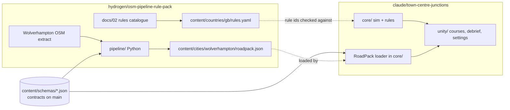

# 08: Parallel Work Plan (Claude + Google Hydrogen)

*Created 2026-11-25. Two AI agents work on separate branches at the same time, and the owner merges both into `main`.*

## 1. Approach
The work is split **by layer, not by feature**, so each agent mostly touches different directories and merges are close to conflict-free. A small set of **contracts** (data schemas + a sample file) is committed to `main` *before* branching. Both agents build against them, so they can work independently and still fit together.

## 2. Branch goals

### Claude, branch `claude/town-centre-junctions`
**Goal:** a playable **town-centre course** that teaches the everyday junction rules, plus the **debrief and replay** loop that makes feedback stick. In detail:
- a hand-authored town centre with traffic lights, a zebra crossing, give-way T-junctions and pedestrians;
- the core prototype rules for those junctions (red light, amber, zebra, give way, pedestrians at junctions, H2);
- a post-drive **debrief with "why you were wrong" replays**;
- a **Settings** screen (steering sensitivity);
- a C# **RoadPack loader** that reads Hydrogen's Wolverhampton pack, so the merge can produce a real-streets drive.

**Done when:** all of the above runs on the OnePlus 12 with green tests, and the loader passes on `content/samples/roadpack.sample.json`.

### Google Hydrogen, branch `hydrogen/osm-pipeline-rule-pack`
**Goal:** the **data side**:
1. a tested Python **OSM → RoadPack v0** pipeline that produces `content/cities/wolverhampton/roadpack.json` for a ~1 km² area of Wolverhampton city centre, with ODbL attribution and per-element confidence;
2. a machine-readable **GB rule pack** (`content/countries/gb/rules.yaml`) generated from `docs/02`, validated against its schema;
3. a **verification pass** on every `UNVERIFIED` item in `docs/02`, using GOV.UK sources;
4. **CI** for the pipeline, plus a weekly **Highway Code update watcher**.

**Done when:** `pytest` passes, the generated pack validates against `content/schemas/roadpack.v0.schema.json`, `rules.yaml` validates and covers every catalogue row, and the CI workflows are green.

### Round 2 (from 2026-11-25, after PR #1)
- **Hydrogen, branch `hydrogen/content-layer`:** the **content layer**:
  - rule strings (plain English, keyed for translation) and a glossary;
  - a GB traffic-sign catalogue (licence checked first);
  - lessons for Stages 0–2 (lessons 1–3 are the free tier);
  - Wolverhampton pack v0.1 (turn restrictions, QA report) and 3 free-drive routes.

  Tasks: `docs/tasks/hydrogen-branch.md`.
- **Claude, branch `claude/town-centre-junctions`:** unchanged (§2 above); the loader can now test on the real Wolverhampton pack.
- Each agent works in its **own folder**:
  - Hydrogen: `coding_space/uk_driving_simulator`;
  - Claude: the git worktree `coding_space/uk_driving_simulator-claude`.

  This keeps the two checkouts from changing under each other.

### Round 3 (from 2026-11-25, after PR #2)
- **Hydrogen, branch `hydrogen/curriculum-and-test-data`:**
  - test-style marking verified on GOV.UK;
  - UI strings for the debrief, settings and HUD, plus a pseudo-locale;
  - Stages 3–5 lessons;
  - Wolverhampton v0.2 junction priority and signal plans;
  - credits and licences text.

  Tasks: `docs/tasks/hydrogen-branch.md`.
- **Claude, branch `claude/town-centre-junctions`:** the town course is done; next come the debrief and replay, settings and the RoadPack loader.

### Round 4 (from 2026-11-25, after PR #3)
- **Hydrogen, branch `hydrogen/wolverhampton-world`:**
  - a rule → lesson index;
  - Wolverhampton v0.3 street widths, footways and building footprints;
  - route directions and a mock-test route;
  - store listing and privacy drafts.

  Tasks: `docs/tasks/hydrogen-branch.md`.
- **Claude:** the keep-left and signal-when-moving-out rules (from play-testing), then the debrief and replay, settings, and the RoadPack loader.

### Round 5 (from 2026-11-25, after PR #4)
- **Hydrogen, branch `hydrogen/lesson-scenarios`:**
  - scripted lesson scenarios (an agreed event vocabulary);
  - learn-card diagrams;
  - the Wolverhampton main network and spawn points (v0.4);
  - a store listing limited to shipped features.

  Tasks: `docs/tasks/hydrogen-branch.md`.
- **Claude:** the RoadPack loader and the Wolverhampton (beta) course, then the scenario player and lesson flow.

### Round 6 (from 2026-11-25, after PR #5)
- **Hydrogen, branch `hydrogen/lessons-complete`:**
  - corrected diagrams (with a visual contact-sheet check);
  - scenarios for lessons 11–18;
  - original knowledge-check quizzes;
  - coach voice lines;
  - Wolverhampton lane connections (v0.5).

  Tasks: `docs/tasks/hydrogen-branch.md`.
- **Claude:** the RoadPack loader and the Wolverhampton (beta) course, then the scenario player and lesson flow.

### Round 7 (from 2026-11-25, after PR #6)
- **Hydrogen, branch `hydrogen/city-life-and-progression`:**
  - a simpler Wolverhampton network (merged short links);
  - pedestrian routes;
  - pedestrian stages at signal crossings (v0.6);
  - lesson progression data (unlocks, stars, review schedule).

  Tasks: `docs/tasks/hydrogen-branch.md`.
- **Claude:** the scenario player and lesson flow, and Wolverhampton polish.

## 3. File ownership (who may edit what)

| Path | Owner | The other agent may |
|---|---|---|
| `core/**`, `unity/**` | Claude | read only |
| `.github/workflows/core-tests.yml` | Claude | read only |
| `pipeline/**` | Hydrogen | read only |
| `content/countries/**`, `content/cities/**`, `content/lessons/**`, `content/scenarios/**`, `content/legal/**`, `content/store/**`, `content/ATTRIBUTIONS.md` | Hydrogen | read only |
| `.github/workflows/pipeline*.yml`, `.github/workflows/highway-code-watch.yml` | Hydrogen | read only |
| `docs/02-rules-catalogue.md` | Hydrogen (verification edits) | read only |
| `docs/tasks/claude-branch.md` | Claude | read; add requests under "Requests from Hydrogen" |
| `docs/tasks/hydrogen-branch.md` | Hydrogen | read; add requests under "Requests from Claude" |
| `content/schemas/**`, `content/samples/**` | **Shared contract**: change only by agreement, recorded in both task files | propose changes |
| `AGENTS.md`, `GEMINI.md`, `docs/00`–`07`, `docs/08` | Owner (user). Agents may append dated notes to the end of `docs/08` | |
| `graphify-out/**` | Regenerated after merges on `main` only | don't edit |

## 4. Contracts (on `main` before branching)
- `content/schemas/roadpack.v0.schema.json`: the road-pack format: link-level road graph, lane counts, speed limits, crossings, signals, zones, confidence, ODbL source block. Local metres: x = east, z = north, from an origin lat/lon.
- `content/samples/roadpack.sample.json`: a tiny valid pack (a T-junction with traffic lights and a zebra). Claude's loader tests use it; Hydrogen's validator tests use it too.
- `content/schemas/rulepack.v0.schema.json`: the machine-readable rule entries (id, plain English, source, force, verified, phase, severity, detection, implementation reference).

## 5. Merge order and checkpoints
1. Hydrogen merges first (independent of Unity), after its CI is green.
2. Claude rebases on `main`, switches the loader test to the real Wolverhampton pack, then merges.
3. Integration step (Claude, after both merges): a "Wolverhampton (beta)" free-drive course built from the pack, with only high-confidence rules firing.
4. After each merge: `dotnet test`, `pytest`, an APK build, and a graphify `--update`.

## 6. Notes (append below, newest last)
- 2026-11-25: plan created; contracts v0 committed to `main`.
- 2026-11-25 (Hydrogen): delivered `ltl_pipeline` (`pipeline/`), `content/cities/wolverhampton/roadpack.json` (953 nodes, 1079 links, 119 crossings, 3 tram-street ways excluded), `content/countries/gb/speed_defaults.yaml`, `content/countries/gb/rules.yaml` (130 rules, all `core/Rules.Core` IDs linked including `GB.RBT.WRONG_WAY` added to `docs/02`), GOV.UK verification of `docs/02` §5, and CI workflows (`pipeline.yml`, `highway-code-watch.yml`). All 18 pytest tests and `ruff check` pass; all content packs validate against v0 schemas. No schema changes needed.
- 2026-11-25 (Claude): reviewed and merged PR #1 (`1a0ebd2`); CI green (dotnet + python). Round 2 tasks were written for Hydrogen. New schemas `strings.v0`, `signs.v0`, `lesson.v0` and `route.v0`, plus the additive roadpack v0.1 `restrictions[]`, are pre-agreed (see both task files).
- 2026-11-25 (Hydrogen, round 2): delivered `pipeline/uv.lock` + `uv sync --frozen` CI, `rules.yaml` diff check in CI, outcome-based OBS/SIG detection alignment in `docs/02` + `rules.yaml`, `strings.v0.schema.json` + 91 Phase P/M English strings + 42-term glossary + `readability.py`, `signs.v0.schema.json` + 17 GB signs with SVGs (DfT OGL v3.0 / Crown copyright verified) + `content/ATTRIBUTIONS.md`, `lesson.v0.schema.json` + 10 Stages 0–2 lessons (lessons 1–3 free tier), Wolverhampton `QA.md` + 13 turn restrictions (`roadpack.v0.schema.json` v0.1) + `route.v0.schema.json` + 3 legal free-drive routes. All 28 pytest tests, `ruff check`, readability linter, and 17 content schema validations pass.
- 2026-11-25 (Claude): reviewed and merged PR #2 (`6266f74`); CI green. Round 3 was written for Hydrogen. Pre-agreed: the `testmarking.v0` schema, the additive `strings.v0` `ui` kind, and the additive roadpack v0.2 `junctionPriority[]` / `signalPlans[]`.
- 2026-11-25 (Hydrogen, round 3): delivered `testmarking.v0.schema.json` + GOV.UK-verified `test_marking.yaml` (15 driving faults, fail on serious/dangerous), `strings.v0` `kind: "ui"` + 29 UI keys (`strings/en/ui.json`) + `en-XA` pseudo-locale + CI diff check, B1 grammar fix (`GB.POS.KEEP_LEFT.why`), `content/lessons/gb/IMPLEMENTATION.md`, Stages 3–5 lessons (`11`–`18`, total 18 lessons), RoadPack v0.2 `junctionPriority[]` (614) & `signalPlans[]` (73) + updated `QA.md`, and `content/legal/en/credits.md`. All 32 pytest tests, `ruff check`, readability linter, and 30 content schema validations pass.
- 2026-11-25 (Claude): reviewed and merged PR #3 (`ab1549e`); CI green; test marking checked against GOV.UK. Round 4 was written for Hydrogen. Pre-agreed: `ruleindex.v0`, `buildings.v0`, roadpack v0.3 `widthM`/`sidewalk`, and route `instructions[]`.
- 2026-11-25 (Hydrogen, round 4): delivered `ruleindex.v0.schema.json` + `rule_index.json` + CI diff check, `debrief.drive_again` / `debrief.keep_driving` UI keys + `en-XA` update, RoadPack v0.3 `widthM`/`sidewalk` + `buildings.v0.schema.json` + Wolverhampton `buildings.json` (568 buildings, 133 KB) + updated `QA.md`, `route.v0` `instructions[]` on all 4 routes including 10-minute `wolverhampton-mock-test` + readability coverage, and draft `content/store/en/listing.md` + `privacy-draft.md`. All 35 pytest tests, `ruff check`, readability linter, and 32 content schema validations pass.
- 2026-11-25 (Claude): reviewed and merged PR #4 (`8ecc4a0`); CI green. The store draft over-claimed (lessons, Wolverhampton and lesson links aren't in the app yet), so it's fixed in round 5. Pre-agreed: `scenario.v0` (fixed event vocabulary), roadpack v0.4 `inMainNetwork`/`mainNetwork`/`spawnPoints[]`, and `lesson.v0` `learnCard.diagram`.
- 2026-11-25 (Hydrogen, round 5): delivered `scenario.v0.schema.json` + 20 scripted scenario files for lessons 1–10 (`content/scenarios/gb/`), `content/store/en/claims.yaml` + honest `listing.md` with `<!-- claim: id -->` tests, RoadPack v0.4 `inMainNetwork` / `mainNetwork` (596 links, 483 nodes) / 12 `spawnPoints[]` + route/spawn tests + `QA.md`, and 18 top-down SVG + 1024×1024 PNG learn-card diagrams (`pipeline/ltl_pipeline/diagrams.py`) linked via `learnCard.diagram`. All 38 pytest tests, `ruff check`, readability linter, and 52 content schema validations pass.
- 2026-11-25 (Claude): reviewed and merged PR #5 (`396fcbb`); CI green; the scenarios check out. The roundabout lane-choice diagram drew its path through the island, and the zebra diagram's centre line ran through the stripes; both are fixed first in round 6, with a contact-sheet review. Pre-agreed: `take_exit` and `finish_after_s` events, `quiz.v0`, `strings.v0` `voice`, and roadpack v0.5 `laneConnections[]`.
- 2026-11-25 (Hydrogen, round 6): fixed roundabout clockwise/left-exit paths and zebra zig-zags across all 18 diagrams + `_contact_sheet.png` + `test_diagrams.py`; added `take_exit` and `finish_after_s` to `scenario.v0` + 16 scenarios for lessons 11–18 (36 total); added `quiz.v0.schema.json` + 18 original B1 quizzes; added `strings.v0` `kind: "voice"` + 25 coach voice lines (`<= 12` words) + `en-XA/voice.json`; and bumped RoadPack to `0.5` with `laneConnections[]` + `QA.md`. All 41 pytest tests, `ruff check`, readability linter, and 88 content schema validations pass.
- 2026-11-25 (Claude): reviewed and merged PR #6 (`551fb08`); CI green; diagrams checked on the contact sheet (clockwise roundabouts, left lanes, zebra zig-zags), and the quizzes are original and correct. Wolverhampton roads are now drawn from the lane graph after play-testing found blobby junctions. Pre-agreed for round 7: `pedroutes.v0`, `progression.v0`, roadpack v0.6 signal-plan pedestrian stages, and link merging with consistent references.
- 2026-11-25 (Hydrogen, round 7): delivered `progression.v0.schema.json` + `progression.json` (Stages 0–5, 1–3 star rules, 1/3/7/14-day review schedule, free tier) + 11 progression/lesson UI keys + `en-XA`, merged plain degree-2 links in `build.py` with full reference rewriting + `test_roadpack_integrity.py` + `QA.md` under-10 m report, `pedroutes.v0.schema.json` + 28 Wolverhampton pedestrian routes (`pedestrians.json`) avoiding buildings and using mapped crossings / H2 mouths, and RoadPack v0.6 `pedestrianStageS` + `crossingIds[]` on signal plans. All 44 pytest tests, `ruff check`, readability linter, and 90 content schema validations pass.
- 2026-11-25 (Claude): reviewed and merged PR #7. Claude's loader and AI still pass on the merged pack (1,001 links, built in about 0.1 s, no overlaps). Round 8 (Wolverhampton destinations, direction signs and the mock-test lesson) is queued in `docs/tasks/hydrogen-round8.md`, from an owner request.
- 2026-11-25 (Hydrogen, round 8): delivered `pois.v0.schema.json` + `content/cities/wolverhampton/pois.json` (149 OSM POIs including 6 in the ~500 m buffer and Queen Square `city_centre`, mapped to `mainNetwork` `accessLinkId`s), `signs-placed.v0.schema.json` + `direction_signs.json` (8 major-junction approach signs with `primary`/`local` GOV.UK styles and shortest-route first-turn directions) + `street_names.json` (372 side-road plates), and lesson 19 (`19-mock-driving-test.json`, Stage 8, `wolverhampton` course, `s8_19_mock_test.json` + `s8_19_mock_test_signs.json` with `independent_driving`, original quiz, diagram, `progression.json`, `rule_index.json`). All 52 pytest tests, `ruff check`, readability linter, and 97 content schema validations pass.
- 2026-11-25 (Claude): merged PR #8 and left review notes as a PR comment. From now on, Hydrogen follows `docs/tasks/hydrogen-roadmap.md` (rounds 9–11, one stacked PR per round). Claude reviews and merges each round in order and talks to Hydrogen through PR comments and the roadmap's Requests sections.
- 2026-11-25 (Hydrogen, round 9): addressed all PR #8 review items: expanded `direction_signs.json` to 71 signs (17 `primary` on A-roads/primary/trunk, 54 `local`) with generic UK destination names, `symbol` per row, max 4 rows, and no unnamed car parks; extended `signs-placed.v0.schema.json` and generated `speed_signs.json` (168 signs), `bus_stops.json` (85 stops), and `warning_signs.json` (6 signs with GOV.UK diagram references). All 53 pytest tests, `ruff check`, readability linter, and 100 content schema validations pass.
- 2026-11-25 (Claude): merged PR #9 (R9). PRs #10 and #11 fail CI (en-XA not regenerated) and are on hold. The test-centre address needs evidence. Rounds 12–14 were added to `docs/tasks/hydrogen-roadmap.md` (fix-ups and roundabouts, Stage 7 conditions, Stage 6 motorways).
- 2026-11-25 (Hydrogen, round 10): verified Piper (MIT) + `en_GB-cori-medium` (CC BY 4.0, OpenSLR 109 / LibriVox) in `content/audio/LICENCES.md`, generated 25 coach voice OGGs (`content/audio/voice/en/`) + 12 CC0 1.0 procedural SFX/loop OGGs (`content/audio/sfx/`, −16 / −23 LUFS) + manifests, added `content/store/en/screenshots.md` (6 shipped-claim captions ≤ 8 words), 14 `a11y.*` keys in `ui.json`, and audio attributions in `ATTRIBUTIONS.md` and `credits.md`. All 57 pytest tests, `ruff check`, and readability linter pass.
- 2026-11-25 (Hydrogen, round 11): verified Wolverhampton Practical Driving Test Centre (Spring Road, Ettingshall, Wolverhampton WV4 6JX) on GOV.UK; built 2 × 2 km `content/cities/wolverhampton-test-area/` pack (RoadPack, buildings, POIs, direction signs, street names, speed signs, bus stops, warning signs, `QA.md`) + 3 legal connected practice routes (`routes.json`, labelled not official test routes); added Lesson 20 (`20-roads-near-test-centre.json`, scenarios `s8_20_test_centre_mix` / `s8_20_test_centre_signs`, original quiz, diagram, `progression.json`, `rule_index.json`). All 58 pytest tests, `ruff check`, readability linter, and 113 content schema validations pass.
- 2026-11-25 (Hydrogen, round 12): fixed `en-XA/ui.json` CI on PRs #10 and #11 (R12.0) and posted quoted GOV.UK `WV4 6JX` test-centre evidence on PR #11 (R12.1); updated `direction_signs.py` for relevant turning/forking + local destinations and route-verified `ref`s (R12.2); enforced 3.25 m game lane clearance and roundabout island avoidance across signs, plates, and street furniture (R12.3); aligned `s8_19` / `s8_20` `durationS` with `independent_driving.minutes` (R12.4); added `roundabout-furniture.v0.schema.json` + `roundabout_furniture.json` for both Wolverhampton packs with GOV.UK diagram citations (R12.5). All 60 pytest tests, `ruff check`, readability linter, and 115 content schema validations pass.
- 2026-11-25 (Hydrogen, round 13): verified Highway Code rules 113–116 and 226–236 on GOV.UK, added `GB.WX.FOG_STOPPING` (Rule 235) to `docs/02` and regenerated `rules.yaml` (131 rules); added `conditions` event to `scenario.v0.schema.json`; delivered Stage 7 lessons 21–23 (night headlights, rain stopping distances, fog < 100 m), 6 scenarios, 3 original quizzes, diagrams, `rules.json` + `voice.json` + OGGs + `en-XA`, and `progression.json`. All 60 pytest tests, `ruff check`, and readability linter pass.
- 2026-11-25 (Hydrogen, round 14): built `content/cities/m54-j2/` RoadPack v0.7 (M54 Junction 2 Coven Heath Interchange, 701 links, `hardShoulder`, `junctionNumber: "2"` slip roads, `gantries[]`, `emergencyAreas[]`, `QA.md`); verified Highway Code rules 253–275 on GOV.UK; added `motorway` course + `join`/`leave` anchors, Stage 6 lessons 24–27, 8 scenarios, 4 original quizzes, diagrams, and `progression.json` (`Stage 5 -> 6 -> 7 -> 8`). All 62 pytest tests, `ruff check`, readability linter, and 144 content schema validations pass.
- 2026-11-25 (Hydrogen, round 15): rewrote player-facing jargon across `rules.json`, lessons, and quizzes into everyday plain English + added `jargon_phrases.txt` to `readability.py` + regenerated `en-XA` (R15.1); updated `direction_signs.py` so approach signs carry 2–4 relevant rows with median >= 2 (R15.2); rebuilt `content/cities/m54-j2/` as a continuous M6 J9–J10A / M54 J2 motorway corridor (411 links, 43 gantries, 4 EAs, >= 4 km per carriageway, 0 service roads) (R15.3); dropped "101" from the test-centre address (R15.4); replaced synthetic `engine_*` with recorded CC0 loops (`domasx2` on OpenGameArt, 2.5–2.7 s mono, −16 LUFS) and updated `LICENCES.md` / `ATTRIBUTIONS.md` / `credits.md` (R15.6); switched all 49 audio clips from Ogg Opus to 16-bit PCM mono 44.1 kHz WAV with codec checks in `test_audio.py` (R15.7). All 62 pytest tests, `ruff check`, and readability linter pass.
- 2026-11-26 (Claude): merged PR #15 (R15: plain English, sign rows, an 11 km M54 section, recorded CC0 sounds; engine loops 3/5, with commercial options listed for the owner). Added rounds 16–18 (motorway furniture and events, practice variety, art from official signs).
- 2026-11-26 (Hydrogen): completed Round 16 (`motorway_signs.json`, `gantry_messages.json`, and `red_x` / `variable_limit` / `slow_vehicle_ahead` / `breakdown` scenario events across `s6_24_*`–`s6_27_*`).
- 2026-11-26 (Hydrogen): completed Round 17 (added 3 varied roundabout practice scenarios, indexed all 27 lessons in `rule_index.json`, updated `IMPLEMENTATION.md` coverage report, and added `test_every_implemented_rule_has_two_practice_scenarios`).
- 2026-11-26 (Hydrogen): completed Round 18 (27 lesson badges in `content/lessons/gb/badges/`, 9 fault icons + `rule_groups.json` in `content/ui/icons/`, 3 1024×1024 app icon concepts in `content/store/icon-concepts/`, and OGL v3.0 attribution updates).
- 2026-11-26 (Hydrogen): completed Round 19 (added plain-English voice lines + Piper WAVs + `manifest.json` + `en-XA` for `GB.JCT.GIVE_WAY`, `GB.JCT.BOX`, `GB.XNG.ZIGZAG_OVERTAKE`; regenerated `rule_index.json` and `IMPLEMENTATION.md`; restored green pipeline CI on `main`).
- 2026-11-26 (Hydrogen): completed Round 20 (replaced racing-car engine loops with CC0 2002 Mini Cooper 1.6L crossfaded WAVs `engine_idle/low/mid/high.wav`, added `advance_1m` + destinations + gantry `junctionNumber` to `m54-j2`, added game-loaded WAV parity tests in `test_audio.py`, and wrote Google Play `content/store/listing/en.md` with length/credit checks in `test_store.py`).
- 2026-11-26 (Hydrogen): completed Round 21 (generated `content/quizzes/gb/bank/` with 56 plain-English theory-style questions across all 14 implemented rules + `INDEX.md` + `test_quiz_bank.py`).
- 2026-11-26 (Hydrogen): completed Round 22 (generated 27 lesson learn-card and 57 scenario briefing Piper WAVs, updated `content/audio/voice/en/manifest.json` to 127 entries, verified text/WAV parity in `test_audio.py`, and recorded line count in `LICENCES.md`).
- 2026-11-26 (Hydrogen): completed Round 23 (wrote Google Play compliance pack under `docs/store/`: `data-safety.md`, `content-rating.md`, `privacy-policy.md`, and `release-checklist.md`).
- 2026-11-26 (Hydrogen): completed Round 24 (added `python -m ltl_pipeline.health`, committed `docs/CONTENT_HEALTH.md`, added warning-only CI step in `pipeline.yml`, and added `test_health.py`).
- 2026-11-26 (Hydrogen): completed Round 25 (built `content/cities/suburb_practice/` RoadPack v0.7 from OSM Tettenhall/Claregate with `SOURCE.md`, `start`/`join` anchors, POIs, and furniture, plus scenarios `s2_suburb_30`, `s3_suburb_minirbt`, `s4_suburb_school` and `test_suburb_practice.py`).
- 2026-11-26 (Hydrogen): completed Round 26 (grew quiz bank to 13 questions per implemented rule = 182 questions, generated `content/quizzes/gb/tests/set-01.json`–`set-10.json` + `README.md`, and verified balance/uniqueness/difficulty mix in `test_quiz_bank.py`).
- 2026-11-26 (Hydrogen): completed Round 27 (added 80 plain-English `.v2`/`.v3` coach voice variants + Piper WAVs + `manifest.json` + `en-XA`, extended `test_audio.py`, and recorded 207 voice lines in `LICENCES.md`).
- 2026-11-26 (Hydrogen): completed Round 28 (added CC0 `rain_loop.wav`, `wipers.wav`, `horn_short.wav`, `road_noise_town.wav`, `gravel_verge.wav`, `footsteps_pedestrian.wav`, updated `LICENCES.md` and `test_audio.py`; omitted `road_noise_motorway.wav` and `brake_squeal_soft.wav` due to no suitable CC0 source).
- 2026-11-26 (Hydrogen): completed Round 29 (built `rural_practice` and `ring_road_practice` OSM packs v0.7 + `SOURCE.md` + 6 scenarios not yet in `progression.json` + `test_practice_areas.py`).
- 2026-11-26 (Hydrogen): completed Round 30 (wrote `docs/TESTING.md` and `docs/CONTENT_GUIDE.md`, and refreshed `content/lessons/gb/IMPLEMENTATION.md` and `docs/CONTENT_HEALTH.md` through R30).
- 2026-11-27 (Hydrogen): completed Round 31 (wired owner-supplied `engine_idle.mp3`/`engine_mid.mp3`, fixed `health.py` `Lesson Quiz`/`Bank`/stage voice-line counts, wired `rural_practice` & `ring_road_practice` into `progression.json` `optionalPractice`, moved `_contact_sheet.png` to `docs/images/diagrams-contact-sheet.png`, and refreshed `IMPLEMENTATION.md` & `CONTENT_HEALTH.md`).
- 2026-11-27 (Hydrogen): completed Round 32 (wrote `docs/specs/next-rules.md` for 20 planned rules, drafted 20 `scenario.v0` files in `content/scenarios/gb/drafts/` + `test_draft_scenarios.py`, raised Stage 7 quiz bank coverage to 40, fixed `Lesson Quiz` glob `gb-*.json` and per-stage rule counts in `health.py`, and refreshed `CONTENT_HEALTH.md`).
- 2026-11-27 (Hydrogen): completed Round 33 (fixed `scan_implemented_rules()` in `rulepack.py` + `test_rules_core_cs_grep_matches_implemented_scan` so `rules.yaml` tracks all 23 `core/Rules.Core` rules vs 108 planned; added quiz banks, Piper voice WAVs + `.v2`/`.v3`, `en-XA`, and >= 2 practice scenarios for the 9 newly-tracked rules; audited `docs/specs/next-rules.md` against GOV.UK with single base severities, `Escalates to`, and exact `PROPOSED` thresholds; wrote `docs/specs/next-rules-2.md` for Batch 2; aligned 40 `draft_*.json` scenarios with 1:1 spec tests; and refreshed `CONTENT_HEALTH.md`, `rule_index.json`, and `IMPLEMENTATION.md`).
- 2026-11-27 (Hydrogen): completed Round 34 (added Stage 4 optional lesson `28-school-zones.json` + 3 school-zone scenarios + 4-question quiz + diagram + narration WAVs; fixed `build.py` `is_junction` to include `stop`/`giveWay` degree-2 OSM nodes, rebuilt `suburb_practice` with `controlledBy: "stop"`, wrote `docs/specs/stop-junctions.md` + 2 STOP scenarios; wrote `docs/specs/complex-roundabouts.md` for real UK 4/5/6-exit roundabouts; and refreshed `CONTENT_HEALTH.md`, `rule_index.json`, `IMPLEMENTATION.md`, and `progression.json`).
- 2026-11-27 (Hydrogen): completed Round 35 (fixed `build.py` to attach degree-2 `stop`/`giveWay` approach nodes to their 3+-arm junction within 25 m so the minor approach link is excluded from `majorLinks`, rebuilt `suburb_practice` with `n_19101408` `controlledBy: "stop"` + `test_every_stop_priority_has_minor_approach_link`, updated STOP scenarios to finish at `join`; wrote `docs/specs/roundabout-4-exit-build.md` for `way=792`; wrote `docs/specs/next-rules-3.md` + 10 drafts for 50 drafts total; audited `set-01`–`set-03` in `docs/specs/theory-audit.md` and rebuilt all 10 sets; and refreshed `CONTENT_HEALTH.md`, `rule_index.json`, and `IMPLEMENTATION.md`).
- 2026-11-27 (Hydrogen): completed Round 36 (added Stage 1 optional lesson `29-turning-left-right.json` + 4 scenarios + 3-question quiz + badge + diagram + narration WAVs; built `content/cities/queslett_roundabout/` pack + `buildings.json` + `roundabout_furniture.json` + 3 `route.v0` routes + `QA.md` + `test_queslett_roundabout.py`; audited `set-04`–`set-10` in `docs/specs/theory-audit.md` and shortened all ~153 long quiz bank sentences to `<= 15` words with 0 bank readability errors; wired `GB.JCT.TURN_FAR_GAP` for 25 implemented / 106 planned rules; and refreshed `CONTENT_HEALTH.md`, `rule_index.json`, `IMPLEMENTATION.md`, and `progression.json`).
