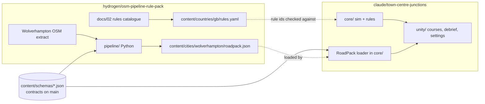

# 08: Parallel Work Plan (Claude + Google Hydrogen)

*Created 2026-11-25. Two AI agents work on separate branches at the same time, and the owner merges both into `main`.*

## 1. Approach
The work is split **by layer, not by feature**, so each agent mostly touches different directories and merges are close to conflict-free. A small set of **contracts** (data schemas + a sample file) is committed to `main` *before* branching. Both agents build against them, so they can work independently and still fit together.

## 2. Branch goals

### Claude, branch `claude/town-centre-junctions`
**Goal:** a playable **town-centre course** that teaches the everyday junction rules, plus the **debrief and replay** loop that makes feedback stick. In detail:
- a hand-authored town centre with traffic lights, a zebra crossing, give-way T-junctions and pedestrians;
- the core prototype rules for those junctions (red light, amber, zebra, give way, pedestrians at junctions, H2);
- a post-drive **debrief with "why you were wrong" replays**;
- a **Settings** screen (steering sensitivity);
- a C# **RoadPack loader** that reads Hydrogen's Wolverhampton pack, so the merge can produce a real-streets drive.

**Done when:** all of the above runs on the OnePlus 12 with green tests, and the loader passes on `content/samples/roadpack.sample.json`.

### Google Hydrogen, branch `hydrogen/osm-pipeline-rule-pack`
**Goal:** the **data side**:
1. a tested Python **OSM → RoadPack v0** pipeline that produces `content/cities/wolverhampton/roadpack.json` for a ~1 km² area of Wolverhampton city centre, with ODbL attribution and per-element confidence;
2. a machine-readable **GB rule pack** (`content/countries/gb/rules.yaml`) generated from `docs/02`, validated against its schema;
3. a **verification pass** on every `UNVERIFIED` item in `docs/02`, using GOV.UK sources;
4. **CI** for the pipeline, plus a weekly **Highway Code update watcher**.

**Done when:** `pytest` passes, the generated pack validates against `content/schemas/roadpack.v0.schema.json`, `rules.yaml` validates and covers every catalogue row, and the CI workflows are green.

### Round 2 (from 2026-11-25, after PR #1)
- **Hydrogen, branch `hydrogen/content-layer`:** the **content layer**:
  - rule strings (plain English, keyed for translation) and a glossary;
  - a GB traffic-sign catalogue (licence checked first);
  - lessons for Stages 0–2 (lessons 1–3 are the free tier);
  - Wolverhampton pack v0.1 (turn restrictions, QA report) and 3 free-drive routes.

  Tasks: `docs/tasks/hydrogen-branch.md`.
- **Claude, branch `claude/town-centre-junctions`:** unchanged (§2 above); the loader can now test on the real Wolverhampton pack.
- Each agent works in its **own folder**:
  - Hydrogen: `coding_space/uk_driving_simulator`;
  - Claude: the git worktree `coding_space/uk_driving_simulator-claude`.

  This keeps the two checkouts from changing under each other.

### Round 3 (from 2026-11-25, after PR #2)
- **Hydrogen, branch `hydrogen/curriculum-and-test-data`:**
  - test-style marking verified on GOV.UK;
  - UI strings for the debrief, settings and HUD, plus a pseudo-locale;
  - Stages 3–5 lessons;
  - Wolverhampton v0.2 junction priority and signal plans;
  - credits and licences text.

  Tasks: `docs/tasks/hydrogen-branch.md`.
- **Claude, branch `claude/town-centre-junctions`:** the town course is done; next come the debrief and replay, settings and the RoadPack loader.

### Round 4 (from 2026-11-25, after PR #3)
- **Hydrogen, branch `hydrogen/wolverhampton-world`:**
  - a rule → lesson index;
  - Wolverhampton v0.3 street widths, footways and building footprints;
  - route directions and a mock-test route;
  - store listing and privacy drafts.

  Tasks: `docs/tasks/hydrogen-branch.md`.
- **Claude:** the keep-left and signal-when-moving-out rules (from play-testing), then the debrief and replay, settings, and the RoadPack loader.

## 3. File ownership (who may edit what)

| Path | Owner | The other agent may |
|---|---|---|
| `core/**`, `unity/**` | Claude | read only |
| `.github/workflows/core-tests.yml` | Claude | read only |
| `pipeline/**` | Hydrogen | read only |
| `content/countries/**`, `content/cities/**`, `content/lessons/**`, `content/legal/**`, `content/store/**`, `content/ATTRIBUTIONS.md` | Hydrogen | read only |
| `.github/workflows/pipeline*.yml`, `.github/workflows/highway-code-watch.yml` | Hydrogen | read only |
| `docs/02-rules-catalogue.md` | Hydrogen (verification edits) | read only |
| `docs/tasks/claude-branch.md` | Claude | read; add requests under "Requests from Hydrogen" |
| `docs/tasks/hydrogen-branch.md` | Hydrogen | read; add requests under "Requests from Claude" |
| `content/schemas/**`, `content/samples/**` | **Shared contract**: change only by agreement, recorded in both task files | propose changes |
| `AGENTS.md`, `GEMINI.md`, `docs/00`–`07`, `docs/08` | Owner (user). Agents may append dated notes to the end of `docs/08` | |
| `graphify-out/**` | Regenerated after merges on `main` only | don't edit |

## 4. Contracts (on `main` before branching)
- `content/schemas/roadpack.v0.schema.json`: the road-pack format: link-level road graph, lane counts, speed limits, crossings, signals, zones, confidence, ODbL source block. Local metres: x = east, z = north, from an origin lat/lon.
- `content/samples/roadpack.sample.json`: a tiny valid pack (a T-junction with traffic lights and a zebra). Claude's loader tests use it; Hydrogen's validator tests use it too.
- `content/schemas/rulepack.v0.schema.json`: the machine-readable rule entries (id, plain English, source, force, verified, phase, severity, detection, implementation reference).

## 5. Merge order and checkpoints
1. Hydrogen merges first (independent of Unity), after its CI is green.
2. Claude rebases on `main`, switches the loader test to the real Wolverhampton pack, then merges.
3. Integration step (Claude, after both merges): a "Wolverhampton (beta)" free-drive course built from the pack, with only high-confidence rules firing.
4. After each merge: `dotnet test`, `pytest`, an APK build, and a graphify `--update`.

## 6. Notes (append below, newest last)
- 2026-11-25: plan created; contracts v0 committed to `main`.
- 2026-11-25 (Hydrogen): delivered `ltl_pipeline` (`pipeline/`), `content/cities/wolverhampton/roadpack.json` (953 nodes, 1079 links, 119 crossings, 3 tram-street ways excluded), `content/countries/gb/speed_defaults.yaml`, `content/countries/gb/rules.yaml` (130 rules, all `core/Rules.Core` IDs linked including `GB.RBT.WRONG_WAY` added to `docs/02`), GOV.UK verification of `docs/02` §5, and CI workflows (`pipeline.yml`, `highway-code-watch.yml`). All 18 pytest tests and `ruff check` pass; all content packs validate against v0 schemas. No schema changes needed.
- 2026-11-25 (Claude): reviewed and merged PR #1 (`1a0ebd2`); CI green (dotnet + python). Round 2 tasks were written for Hydrogen. New schemas `strings.v0`, `signs.v0`, `lesson.v0` and `route.v0`, plus the additive roadpack v0.1 `restrictions[]`, are pre-agreed (see both task files).
- 2026-11-25 (Hydrogen, round 2): delivered `pipeline/uv.lock` + `uv sync --frozen` CI, `rules.yaml` diff check in CI, outcome-based OBS/SIG detection alignment in `docs/02` + `rules.yaml`, `strings.v0.schema.json` + 91 Phase P/M English strings + 42-term glossary + `readability.py`, `signs.v0.schema.json` + 17 GB signs with SVGs (DfT OGL v3.0 / Crown copyright verified) + `content/ATTRIBUTIONS.md`, `lesson.v0.schema.json` + 10 Stages 0–2 lessons (lessons 1–3 free tier), Wolverhampton `QA.md` + 13 turn restrictions (`roadpack.v0.schema.json` v0.1) + `route.v0.schema.json` + 3 legal free-drive routes. All 28 pytest tests, `ruff check`, readability linter, and 17 content schema validations pass.
- 2026-11-25 (Claude): reviewed and merged PR #2 (`6266f74`); CI green. Round 3 was written for Hydrogen. Pre-agreed: the `testmarking.v0` schema, the additive `strings.v0` `ui` kind, and the additive roadpack v0.2 `junctionPriority[]` / `signalPlans[]`.
- 2026-11-25 (Hydrogen, round 3): delivered `testmarking.v0.schema.json` + GOV.UK-verified `test_marking.yaml` (15 driving faults, fail on serious/dangerous), `strings.v0` `kind: "ui"` + 29 UI keys (`strings/en/ui.json`) + `en-XA` pseudo-locale + CI diff check, B1 grammar fix (`GB.POS.KEEP_LEFT.why`), `content/lessons/gb/IMPLEMENTATION.md`, Stages 3–5 lessons (`11`–`18`, total 18 lessons), RoadPack v0.2 `junctionPriority[]` (614) & `signalPlans[]` (73) + updated `QA.md`, and `content/legal/en/credits.md`. All 32 pytest tests, `ruff check`, readability linter, and 30 content schema validations pass.
- 2026-11-25 (Claude): reviewed and merged PR #3 (`ab1549e`); CI green; test marking checked against GOV.UK. Round 4 was written for Hydrogen. Pre-agreed: `ruleindex.v0`, `buildings.v0`, roadpack v0.3 `widthM`/`sidewalk`, and route `instructions[]`.
- 2026-11-25 (Hydrogen, round 4): delivered `ruleindex.v0.schema.json` + `rule_index.json` + CI diff check, `debrief.drive_again` / `debrief.keep_driving` UI keys + `en-XA` update, RoadPack v0.3 `widthM`/`sidewalk` + `buildings.v0.schema.json` + Wolverhampton `buildings.json` (568 buildings, 133 KB) + updated `QA.md`, `route.v0` `instructions[]` on all 4 routes including 10-minute `wolverhampton-mock-test` + readability coverage, and draft `content/store/en/listing.md` + `privacy-draft.md`. All 35 pytest tests, `ruff check`, readability linter, and 32 content schema validations pass.
